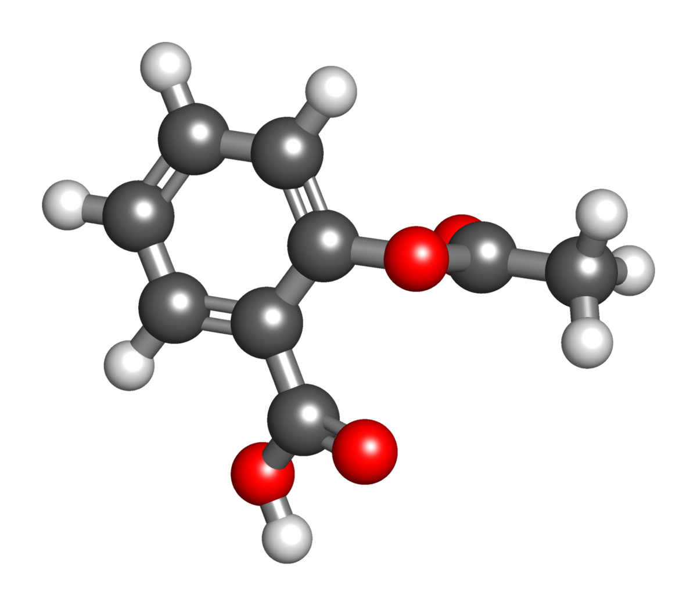

# WikiMolGen 2

Molecule figures for Wikipedia, rendered in the browser.

Load a compound by name, PubChem CID or SMILES, or a protein by PDB ID. The structure is
fetched straight from PubChem or RCSB, drawn with [patinae](https://github.com/zmactep/pymol-rs)
in WebAssembly or as a 2D skeletal SVG, and handed back together with the `{{Infobox drug}}`,
`{{Chembox}}` and Wikimedia Commons markup that goes around it.

It is a static site: no server, no upload, no install.

What it offers:

* **Lookup without codes.** Type a name, and PubChem and the PDB answer in the field. A
  local index of 58 compounds and 13 proteins answers at once; live PubChem autocomplete
  and RCSB full-text search cover the rest. A CID, a SMILES or a PDB ID still works.
* **2D and 3D.** RDKit's MinimalLib draws the skeletal SVG with no background, plus
  element colours and stereo. Ball-and-stick, space-filling, licorice, stick and protein
  cartoons cover 3D.
* **Three themes.** Light, Paper and Dark, plus System. The choice persists across visits,
  and the stage follows the theme tint.
* **A colour panel for the 3D figure.** Colour by element, chain, residue type, residue
  number, secondary structure, B-factor or one ink. Seven element palettes: CPK, Jmol,
  RasMol, ChemDraw, VMD, print inks and a dark-figure palette. Sticks follow the atoms or
  take one ink, secondary-structure cartoons take three inks, and any element is
  overridable. The 2D drawing keeps RDKit's own element colours.
* **Named looks and controls.** Publication, Flat and Dark finishes, plus light, outline,
  ambient occlusion, depth cue and transparency. The default look is WikiMolGen's preset:
  CPK spheres, grey sticks and a white page.
* **Short panel, shareable links.** The long control sections fold away and remember their
  state. A lookup writes `?q=` to the address, so a reload or a shared link reopens the
  same compound.
* **Figures, not screenshots.** The view switch, full screen and the download sit in the
  figure toolbar. PNG at any width from 400 to 8192 px, with presets at 1200, 1600, 2000,
  3000, 4096, 6000 and 8192. A batch export takes one identifier per line and returns one
  ZIP with a figure per item, using the same look and settings. Orientation presets
  normalise the view: wiki (10°, 20°), front, side and top, plus custom angles. The default is 4x supersampling, with 2x, 3x and 6x selectable. The background
  is transparent by default, and an optional colour or gradient is one click away. Atom
  labels and a scale bar are available.
* **Metadata for the markup.** Wikidata identifiers and ATC codes, Wikipedia clinical
  fields and an openFDA drug label fill the infobox and chembox fields. The page shows the
  figure and the markup; it does not repeat the fields in a panel.

The 2D engine is RDKit.js, 7.39 MB, loaded only when the 2D view first opens. Until then
the page stays at about 624 KB of wasm. The drawing has no background, so the stage tint
shows through. A Rust V2000 parser is the fallback if the RDKit module cannot load.


The drug infobox, the chembox and the Commons upload text sit together below the figure.
Each box has a Copy action in its top-right corner; the Commons block carries the upload link:


View comes first, then Export, and every category starts folded. Appearance opens with a Preset
row: the original Wikipedia settings, plus Save and Delete for your own presets, then groups its
controls as shape, light, effects and surface:


The colour panel: the element palette, the stick ink and the per-element overrides.


The figure fills the stage, and full screen gives it the whole display.


An exported figure, aspirin, ball and stick, cropped and padded by the app itself:



Rendering needs WebGPU. There is no WebGL2 fallback: the renderer is WebGPU-only, and the
page says so plainly instead of drawing something lesser. Chrome 113+, Edge 113+ and
Safari 26 on a supported GPU work; anything else gets an explanation, and the markup half
of the app keeps working.

## Build

Requirements: a Rust toolchain with the `wasm32-unknown-unknown` target,
`wasm-bindgen-cli` matching the version `Cargo.lock` pins, and Node 20+.

```powershell
# 1. The Rust half: figure post-processing and markup (release build)
cargo build --target wasm32-unknown-unknown --release -p wikimolgen2_wasm
wasm-bindgen --target web --out-dir web/pkg `
  target/wasm32-unknown-unknown/release/wikimolgen2_wasm.wasm

# 2. The page
cd web
npm install
npm run dev
```

On this workstation the toolchain lives outside the user profile; source
`scripts/dev-env.ps1` first and the commands above work unchanged.

Tests for everything that can be tested without a browser:

```powershell
cargo test -p wikimolgen2_core
```

CI runs the same tests, builds the wasm bundle and runs the Vite build on every push to
`patinae-rewrite` and on every pull request: [.github/workflows/ci.yml](.github/workflows/ci.yml).
The browser check stays local because it needs a GPU.

End-to-end check in a real browser: it serves `web/dist`, loads a compound through the
page's own controls, asserts the markup and exports a PNG, then writes a screenshot.

```powershell
node scripts/verify.mjs --url http://localhost:5173/ --headed true --gpu hardware
```

## How it is put together

* `crates/wikimolgen2_core`, the 2D depiction, the figure composition, the presets, the
  element palettes and the wikitext generators. No browser, no GPU, so it is unit-tested
  natively.
* `crates/wikimolgen2_wasm`, the Rust that has to run in the browser: writes the SVG,
  composes a rendered PNG into a figure, and generates the markup. It does not render.
* `web/src/`, Vite + TypeScript: lookups, metadata, controls, downloads, and the adapter
  that drives the renderer (`renderer.ts`).
* `web/public/vendor/`, the renderer (patinae) and the 2D engine (RDKit). Both are
  vendored builds with provenance notes beside them.

The renderer is patinae (formerly PyMOL-RS), not `molar_vis`. Why it was swapped, what the
swap cost, and what it gives up, notably a WebGL2 fallback, are in
[docs/ADR-0002-renderer-patinae.md](docs/ADR-0002-renderer-patinae.md); the earlier design
and its reasoning are kept in
[docs/ADR-0001-architecture.md](docs/ADR-0001-architecture.md), and what is in and out of
the current scope is in [docs/SPEC.md](docs/SPEC.md).

## Status

The 2D and 3D paths work end to end: look a compound up, pick a look, export a figure,
and paste the markup. A protein cartoon works from a PDB ID, and the metadata from
Wikidata, Wikipedia and openFDA fills the summary and the infobox fields.

Known gaps are listed in [docs/SPEC.md](docs/SPEC.md): conformer generation for a SMILES
that PubChem does not know, ray tracing, MSAA in the live view, a live background
gradient, export edges above 8192 px, and a direct DailyMed read (openFDA serves the same
labels). The renderer's own problems, and the feature requests that follow from them, are
recorded in [docs/PATINAE-GAPS.md](docs/PATINAE-GAPS.md). The Rust 2D fallback reads V2000
only; the RDKit path also reads V3000.

WebGPU is required for 3D and the path is exercised: `scripts/verify.mjs --gpu hardware`
reports the live backend, loads aspirin and exports a figure on real hardware. The 2D SVG
and the markup still work when the 3D viewer cannot start.

## Licence

MIT OR Apache-2.0. The renderer (patinae) is BSD-3-Clause; its build is vendored
unmodified under `web/public/vendor/patinae` with the licence beside it.
