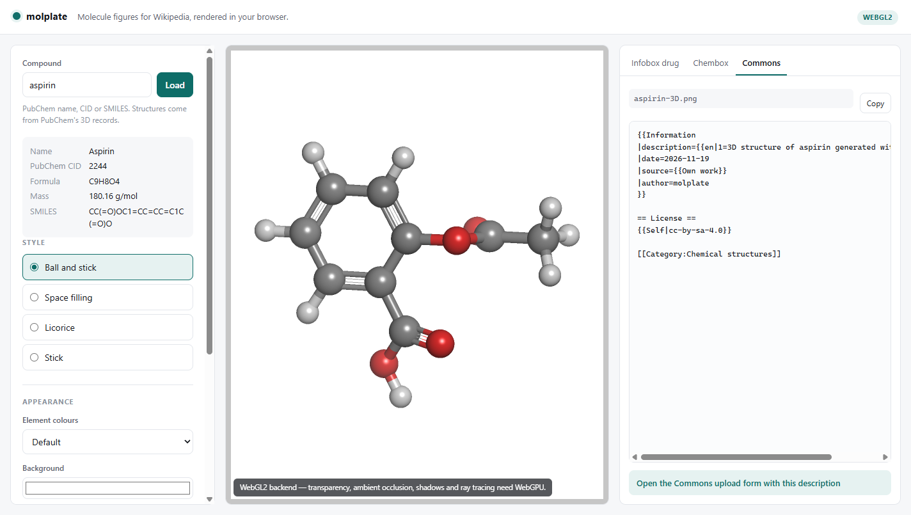
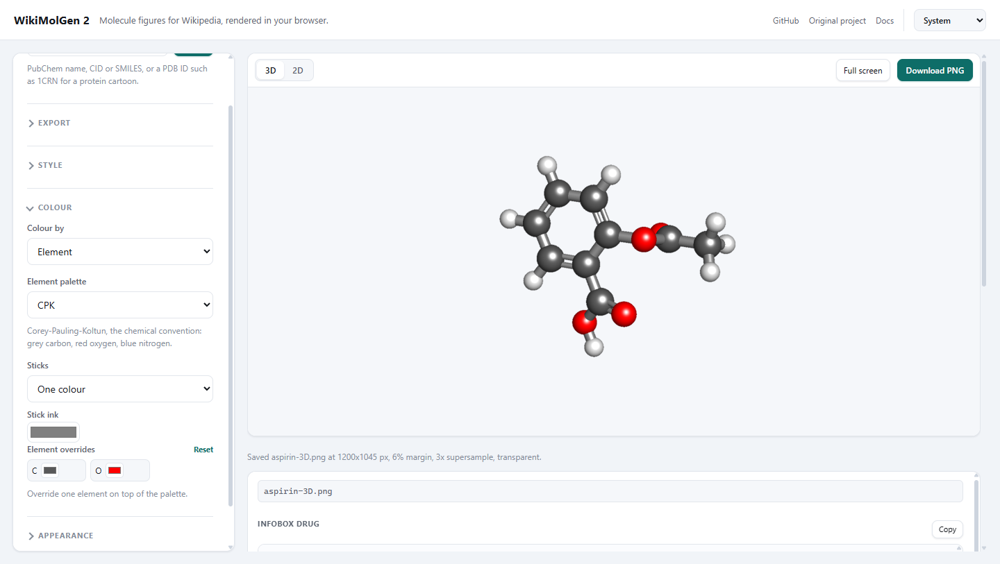
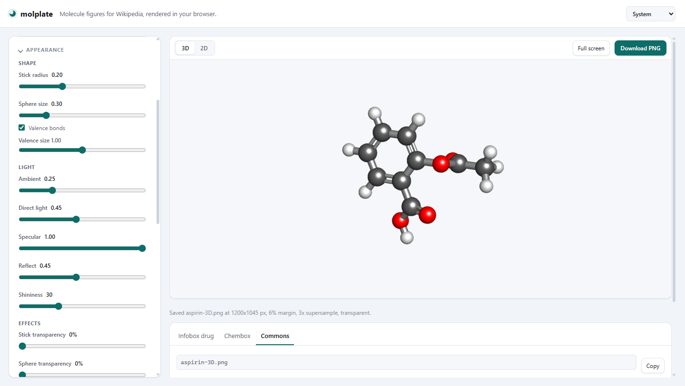
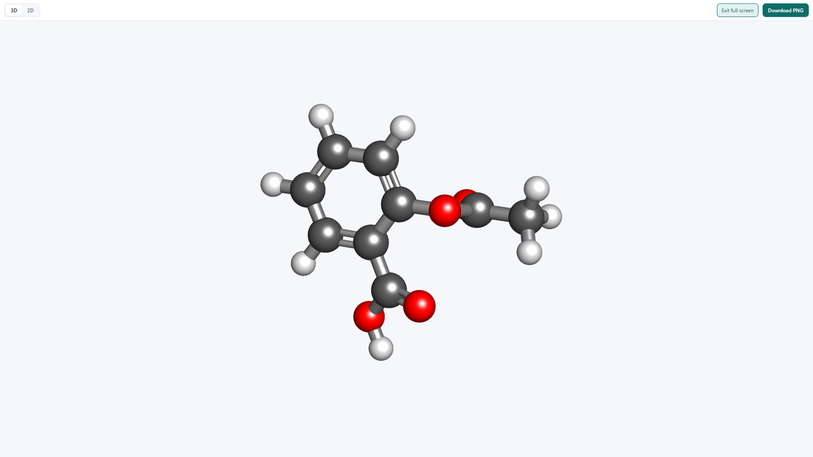
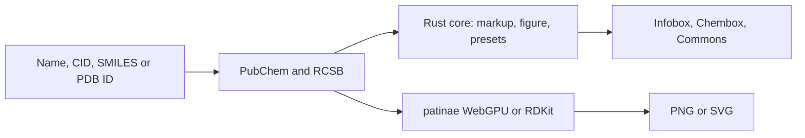

<div align="center">

# WikiMolGen 2

Molecule figures for Wikipedia, rendered in the browser.

[](crates/wikimolgen2_core)
[](web)
[](docs/ADR-0002-renderer-patinae.md)
[](LICENSE)

</div>



Type a compound name, a PubChem CID or a SMILES, or a PDB ID. The structure comes straight from PubChem or RCSB and is drawn by [patinae](https://github.com/zmactep/pymol-rs) in WebAssembly, or by RDKit as a skeletal SVG. The page also writes the `{{Infobox drug}}`, `{{Chembox}}` and Wikimedia Commons markup around the figure.

It is a static site: no server, no upload, no install.

## What it does

| Area | What it gives you |
| --- | --- |
| Lookup | 58 compounds and 13 proteins answer from the built-in catalogue. Live PubChem autocomplete and RCSB full-text search cover the rest. A CID, a SMILES or a PDB ID still works |
| 3D | Ball-and-stick, space filling, licorice, stick and protein cartoons, with seven element palettes and a colour mode for element, chain, residue, secondary structure, B-factor or one ink |
| 2D | RDKit's MinimalLib draws the skeletal SVG with stereo and no background. A Rust V2000 parser is the fallback |
| Looks | Publication, Flat, Dark, Space filling, Licorice and Stick for small molecules, plus cartoon looks for proteins |
| Appearance | Stick and sphere size, valence, light, transparency, depth cue, ambient occlusion, soft shadows, outline, smooth edges and projection |
| Presets | The original Wikipedia render settings, saved and renamed presets, orientation presets (wiki, front, side, top, custom) and the seven colour schemes |
| Export | PNG from 400 to 8192 px wide, 2x to 6x supersampling, 4 to 9 percent margin, optional labels and scale bar, transparent by default, or one ZIP for a batch of identifiers |
| Markup | `{{Infobox drug}}`, `{{Chembox}}` and the Commons upload text, with metadata from Wikidata, Wikipedia and openFDA |
| Links | A lookup writes `?q=` to the address. The theme and the open sections survive a reload |

## See it

| | |
| --- | --- |
|  |  |
| The markup panel, each box with its own copy action | Colour by element, with per-element overrides |
|  |  |
| The shape, light and surface controls | Full screen gives the figure the whole display |

An exported figure, cropped and padded by the app itself:


## Build

Requirements: a Rust toolchain with the `wasm32-unknown-unknown` target, `wasm-bindgen-cli` matching the version in `Cargo.lock`, and Node 20 or newer.

```powershell
cargo build --target wasm32-unknown-unknown --release -p wikimolgen2_wasm
wasm-bindgen --target web --out-dir web/pkg `
  target/wasm32-unknown-unknown/release/wikimolgen2_wasm.wasm

cd web
npm install
npm run dev
```

The tests that need no browser:

```powershell
cargo test -p wikimolgen2_core
```

CI runs those tests, builds the wasm bundle and runs the Vite build on every push and pull request: [.github/workflows/ci.yml](.github/workflows/ci.yml).

The browser check serves `web/dist`, drives the page's own controls, asserts the markup and exports a PNG:

```powershell
node scripts/verify.mjs --url http://localhost:5173/ --headed true --gpu hardware
```

## How it works



* `crates/wikimolgen2_core` holds the chemistry, the figure composition, the presets, the element palettes and the wikitext generators. It runs without a browser, so it is unit tested natively.
* `crates/wikimolgen2_wasm` is the part that runs in the page: SVG, figure composition and markup. It does not render.
* `web/src/` is Vite and TypeScript: lookup, metadata, controls, downloads and the adapter that drives the renderer.
* `web/public/vendor/` holds the renderer and the 2D engine, with provenance notes beside both builds.

The renderer choice and its cost, including the missing WebGL2 fallback, are in [docs/ADR-0002-renderer-patinae.md](docs/ADR-0002-renderer-patinae.md). The earlier design is in [docs/ADR-0001-architecture.md](docs/ADR-0001-architecture.md), and the scope is in [docs/SPEC.md](docs/SPEC.md).

## Limits

* Rendering needs WebGPU. There is no WebGL2 fallback. Chrome 113+, Edge 113+ and Safari 26 on a supported GPU work; other browsers get an explanation and the markup half still works.
* The RDKit module is 7.39 MB and loads on the first 2D view. The Rust fallback reads V2000 only.
* Ray tracing and MSAA are not in the live view. FXAA and a 2x supersampled canvas are the substitutes.
* The renderer exports one view at a time. A figure that needs an edge above 8192 px needs tiling, which the renderer does not expose.
* The live surface is opaque, so a live background gradient and true alpha are export-only or unavailable.
* DailyMed sends no CORS header. openFDA serves the same labels.
* A SMILES that PubChem does not know needs a conformer generator, which the app does not have.

## Licence

The source code is under the [PolyForm Noncommercial License 1.0.0](LICENSE), the same licence as the original [WikiMolGen](https://github.com/Wolren/WikiMolGen).

That licence covers the software only. Figures, SVGs and wikitext you generate are yours to licence as you see fit. The Commons template defaults to CC BY-SA 4.0 for a 3D figure and PD-chem for a 2D drawing.

The renderer, patinae, is BSD-3-Clause, Copyright (c) 2026, Pavel Yakovlev. RDKit is BSD-3-Clause, Copyright (c) 2006-2015, Rational Discovery LLC, Greg Landrum, and Julie Penzotti and others. The full texts are in [LICENSES](LICENSES/README.md) and beside each vendored build.
