# Upgrade report: visuals and capability

Date: 2026-11-21. Branch: `patinae-rewrite`. Base commit: `5d06e5d`, the session prompt
commit on top of `7a61796`. The work is six workstream commits, this report, and two
follow-ups for the RDKit engine and the themes. Nothing is pushed.

The renderer is unchanged. Every improvement uses patinae's command surface or runs in
Rust and the page. The figure path now composes an offscreen render at an exact width.
The app also draws 2D skeletons and protein cartoons. It reads metadata from three
sources and offers a keyboard path from load to export.

## Results at a glance

| Workstream | Acceptance | Result |
| --- | --- | --- |
| A. 2D depiction | Aspirin SVG under 100 KB, element colours, downloads from the UI | RDKit SVG 8652 bytes, `#FF0000` oxygen, `aspirin-2D.svg` |
| B. 3D quality | Artwork, three named looks, pair against `/classic/` | Publication, Flat and Dark look data in Rust; images below |
| C. Protein cartoons | 1CRN cartoon in under 3 s, colour by secondary structure | 0.09 to 1.82 s, 327 atoms, 46 residues, 131 helix atoms in pink |
| D. Composition | 1600 px wide, margins 5 to 7 percent, no clipped atoms | 1600x1394, 6.00 percent on all sides, 0 edge ink, transparent by default |
| E. Sources | Same render by name, CID and SMILES, one new field | SHA-256 `0E9E…B6FD` for all three; ATC, routes and legal status added |
| F. Interface | 1280 and 800 px screenshots, no overflow, keyboard path | Scroll width equals viewport at both widths; keyboard export completed |

## Before

The page before the upgrade. One 3D look, four presets, a background picker and a wide
export control.

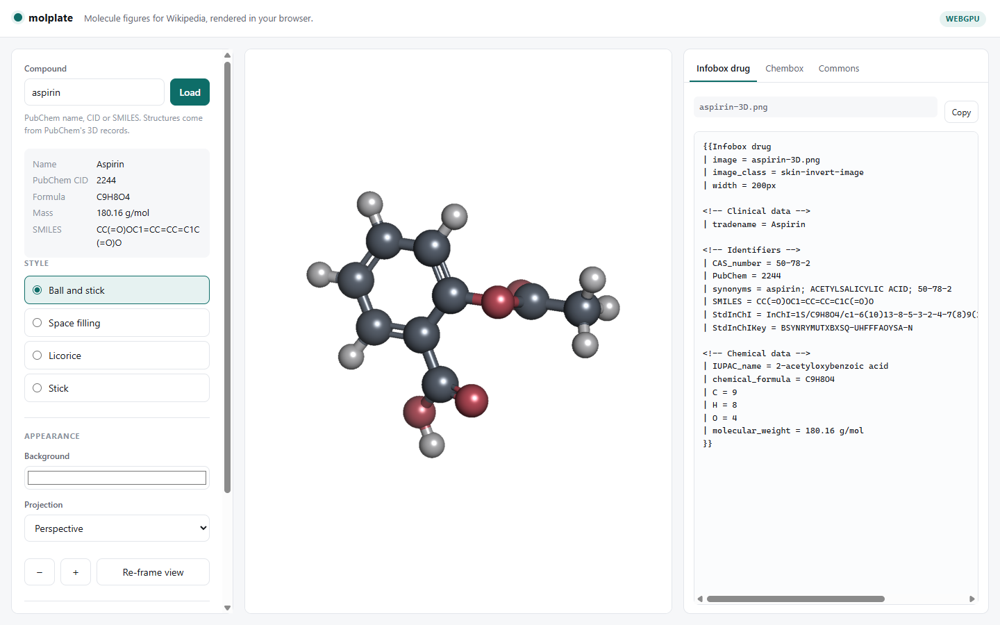

The old renderer, served at `/classic/` from commit `57e912e`, for the renderer pair:

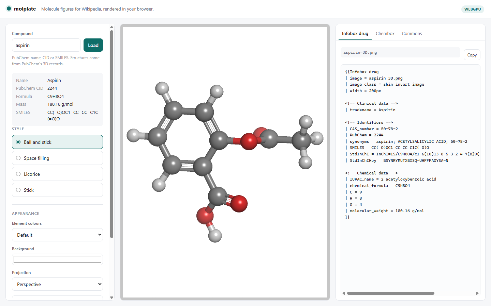

An export requested at 1600 px came out at 1319x1144. The crop and the margin were
content-driven, so the requested width was a suggestion.

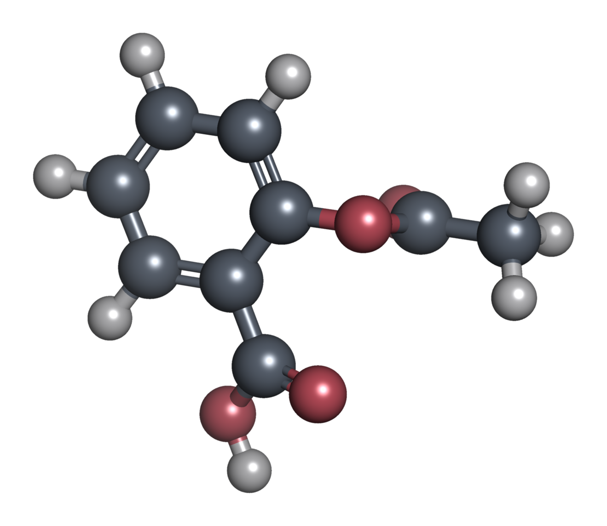

## After

The same compound, the same page size, the Publication look:

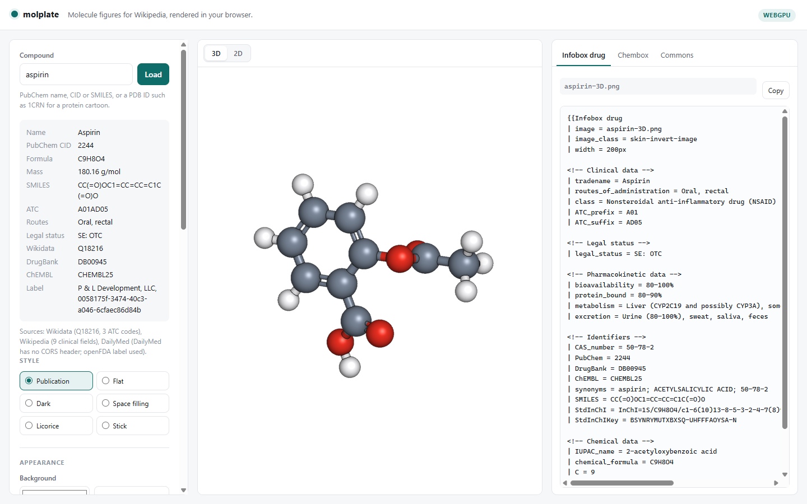

The Dark look. The carbon and hydrogen overrides make the molecule readable on a dark
ground. Ambient occlusion and depth cue are on.

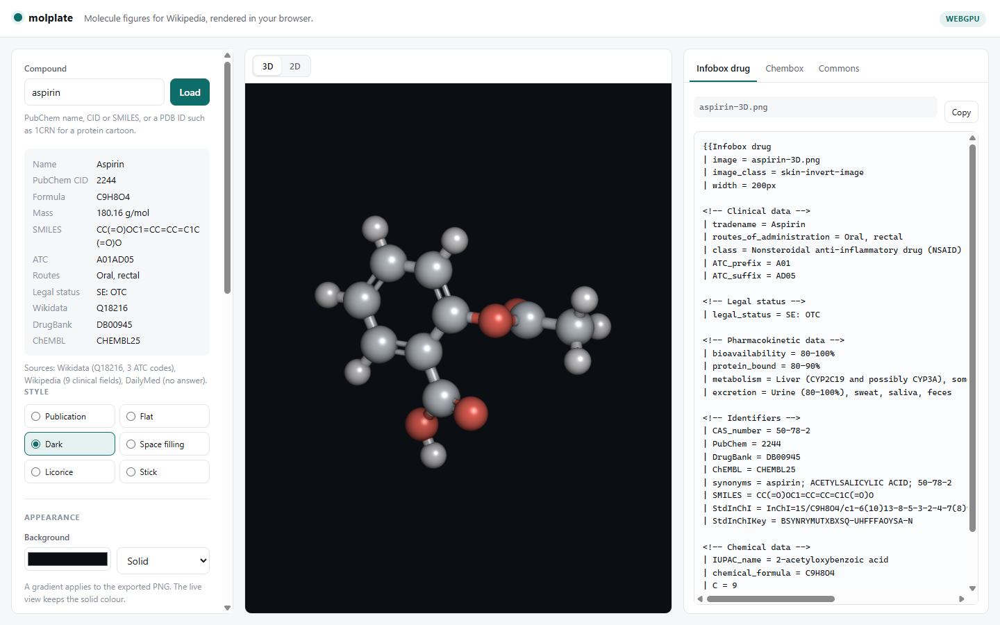

## A. 2D depiction

The 2D view uses RDKit's official MinimalLib build, `@rdkit/rdkit` 2026.9.2. The module
loads on the first 2D open, so the initial page stays at 623.61 KB of wasm. RDKit reads
the mol block and removes the explicit hydrogens. It lays the molecule out with
`set_new_coords`, then returns an SVG with element colours and stereo wedges.

The module is 7.39 MB of wasm. It is a classic script, so the page loads it with a script
tag from `web/public/vendor/rdkit`. The wasm sits beside the script. A Rust V2000 parser
stays as the fallback when the module cannot load.

The first cut used only the Rust parser. This revision restores RDKit as the primary
engine. The project notes named it, and it is the right tool for depiction.

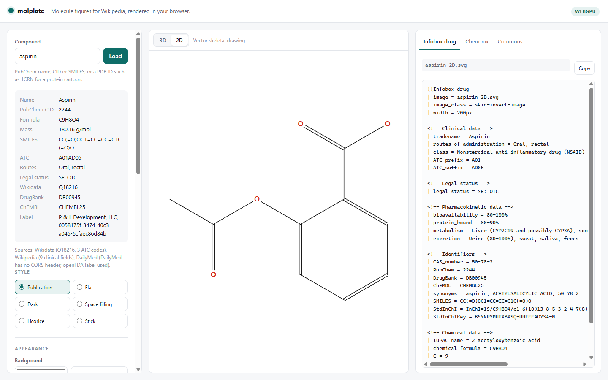

Measured: `aspirin-2D.svg` is 8652 bytes and the inline SVG is 8716 characters. It has no
background rectangle, so the theme tint shows through. Oxygen is `#FF0000` and carbon is
black. The file downloads from the same button that exports the PNG. In the dark theme the
inline bonds take the theme ink; the downloaded file keeps black bonds for print. The first
2D open shows the engine load in the stage overlay. The Rust fallback is covered by six
integration tests and the core suite.

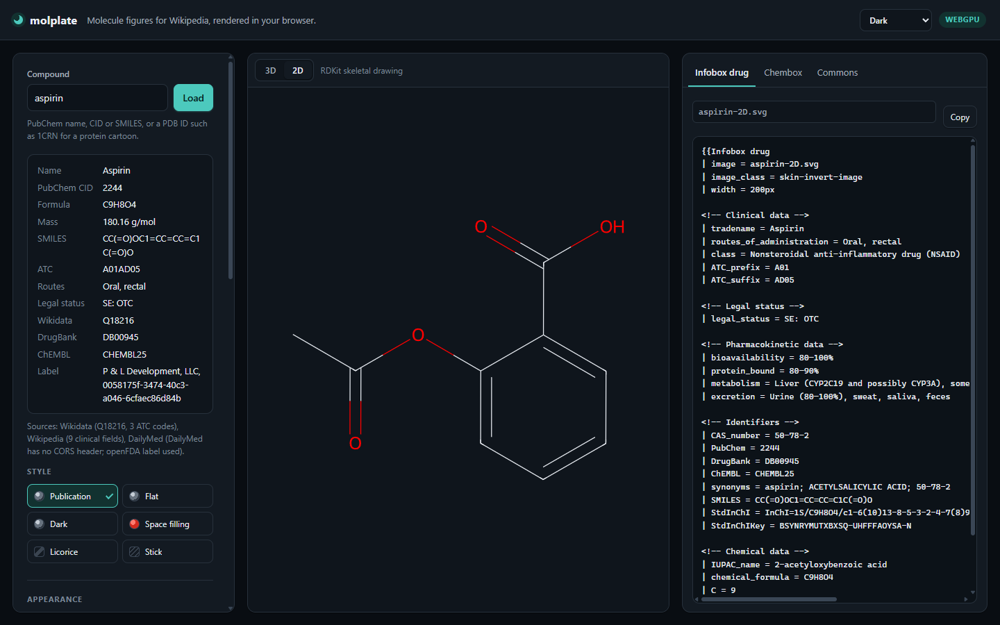

## B. 3D quality controls

`molplate_core::style::Appearance` now carries the knobs that patinae already exposes:

| Group | Controls |
| --- | --- |
| Finish | stick radius, sphere scale, transparency for sticks, spheres and cartoons |
| Light | ambient, direct, reflect, specular, shininess, optional shadow map |
| Quality | screen-space ambient occlusion and strength, silhouette outline and width, depth cue and fog |
| Colour | background, export gradient, per-element overrides through `set_color` and `color` |
| Camera | perspective or orthographic, re-frame, zoom |

The adapter maps each field to a command. Values that reload a shader are remembered and
sent only when they change. The named looks are data. `looksJson()` returns Publication,
Flat and Dark, and the page sends the chosen object back unchanged. A new look needs no
code.

The panel now exposes Reflect, Shininess, Soft shadows, AO strength, Outline width and
Fog. The background and the export gradient sit in the Export block, because they affect
the file, not the stage.

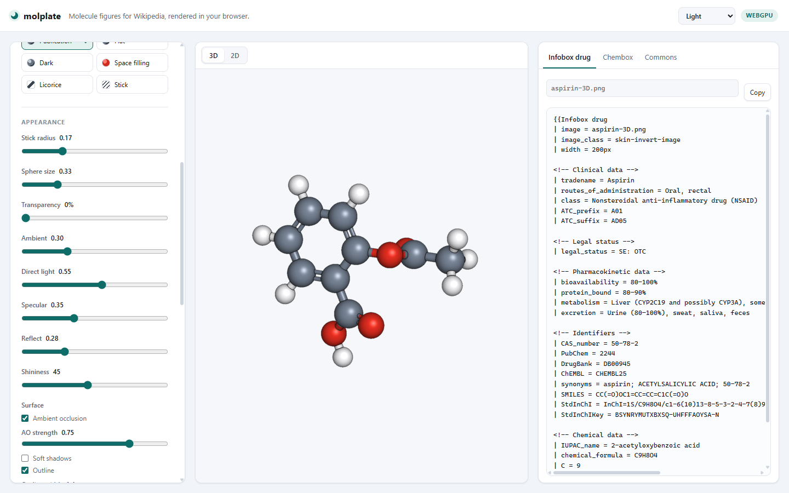

The classic renderer pair:

| Classic, `/classic/` | New, Publication |
| --- | --- |
|  |  |

The old renderer exposed six element palettes and no outline, occlusion or depth control.
The new one draws an outline and ambient occlusion by default, and the dark look uses
element overrides. The gradient is export-only: patinae's canvas surface is opaque, so a
CSS gradient cannot show through. The control says so.

## C. Protein cartoons

A four-character PDB ID such as `1CRN`, or `pdb:` plus an ID, fetches the entry from RCSB.
The PDB reader runs DSSP on load (`auto_dss` is on). The cartoon is coloured through the
`ss` selections. The renderer's `color ss` scheme coloured this scene uniformly, so the
adapter uses three explicit selections. The selection reports 131 helix atoms, 44 sheet
atoms and 152 loop atoms, so the assignment is real.

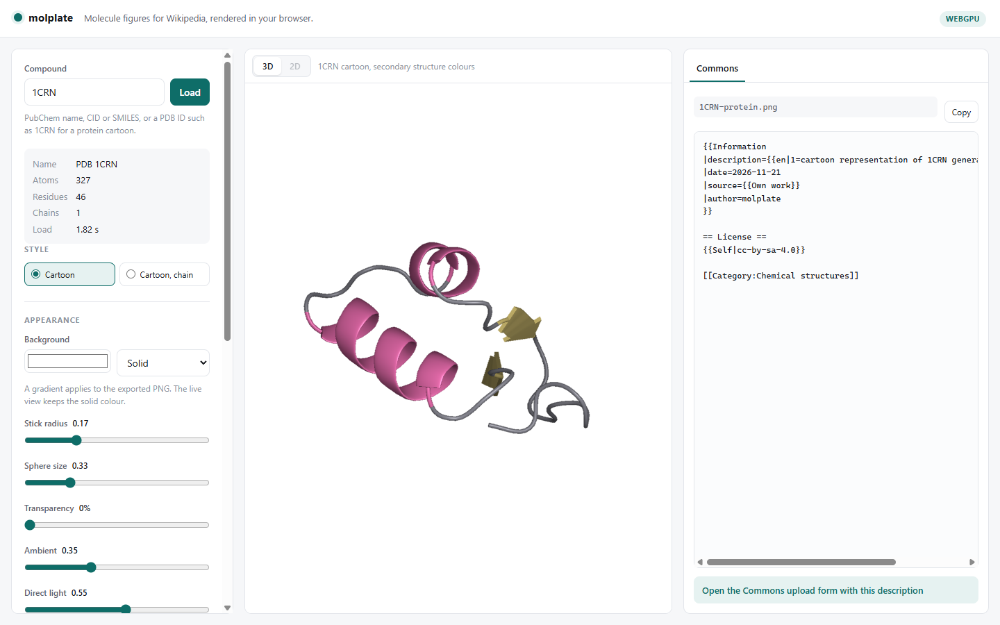

Timing on 1CRN: 327 atoms, 46 residues, one chain. The recorded loads were 0.09 s to
1.82 s (fetch, parse, style and two painted frames). The first cartoon frame costs about
3 s of pipeline compilation when the GPU cache is cold. The app pays that cost at startup
by rendering a six-residue probe. The cold load was 3.25 s before the warm-up. Warm loads
are under 2 s. Startup rises to about 4 s on a cold cache. That is a deliberate trade: a
user waits once at startup, not on each protein.

## D. Figure composition

`molplate_core::figure` composes the figure. The input is the raw supersampled render,
which is 3x by default. The steps are:

1. Trim the uniform background.
2. Scale the content to `width - 2 * margin_px`.
3. Pad the margin with the background, or with an export gradient behind a transparent
   render.
4. Draw the optional scale bar in the bottom margin.

The width is exact because the content is scaled to the inner width. No atom can leave the
canvas because the scale is computed from the trimmed content.

| Measure | Before | After |
| --- | --- | --- |
| Requested width | 1600 px | 1600 px |
| Written width | 1319 px | **1600 px** |
| Written height | 1144 px | 1394 px |
| Left and right margin | 71 px, 5.38 percent | 96 px, **6.00 percent** |
| Top and bottom margin | 71 px | 96 px (plain figure) |
| Clipped content | no | no |
| Ink on the outer edge | 0 px | 0 px |

The 1600 px figure, plain:

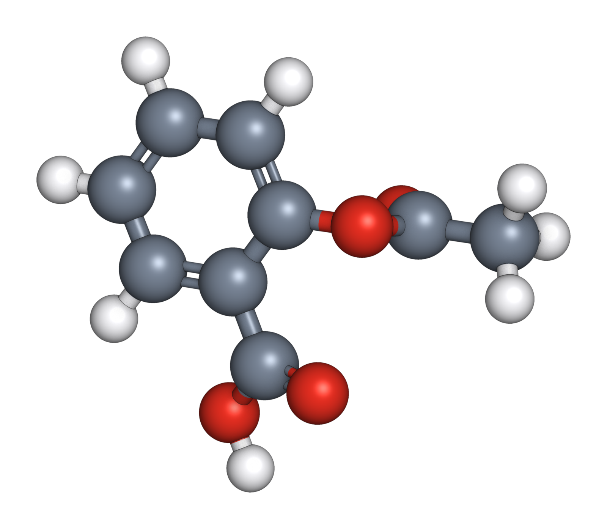

The same figure with atom labels and a 2 Angstrom scale bar. The bar is drawn from the
camera's visible height, read through `get_view`, and rescaled with the trimmed content.

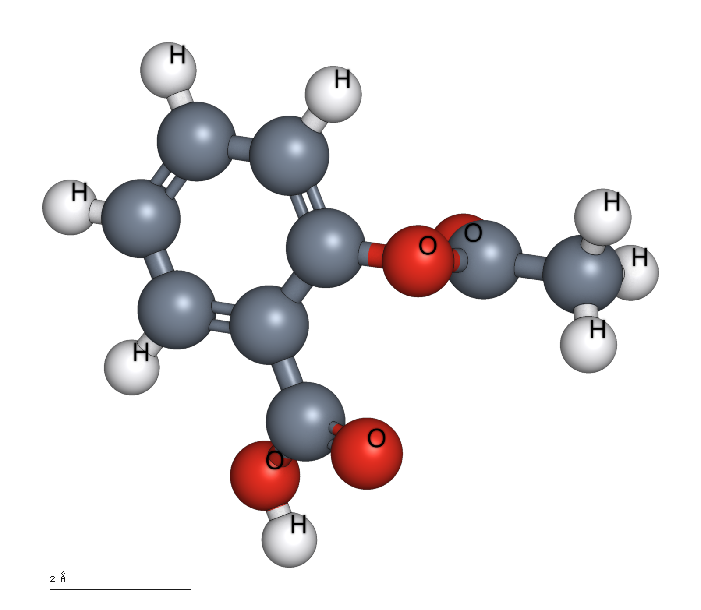

A gradient export. The render is transparent, and the gradient is composited behind it in
Rust, so the edges stay clean.

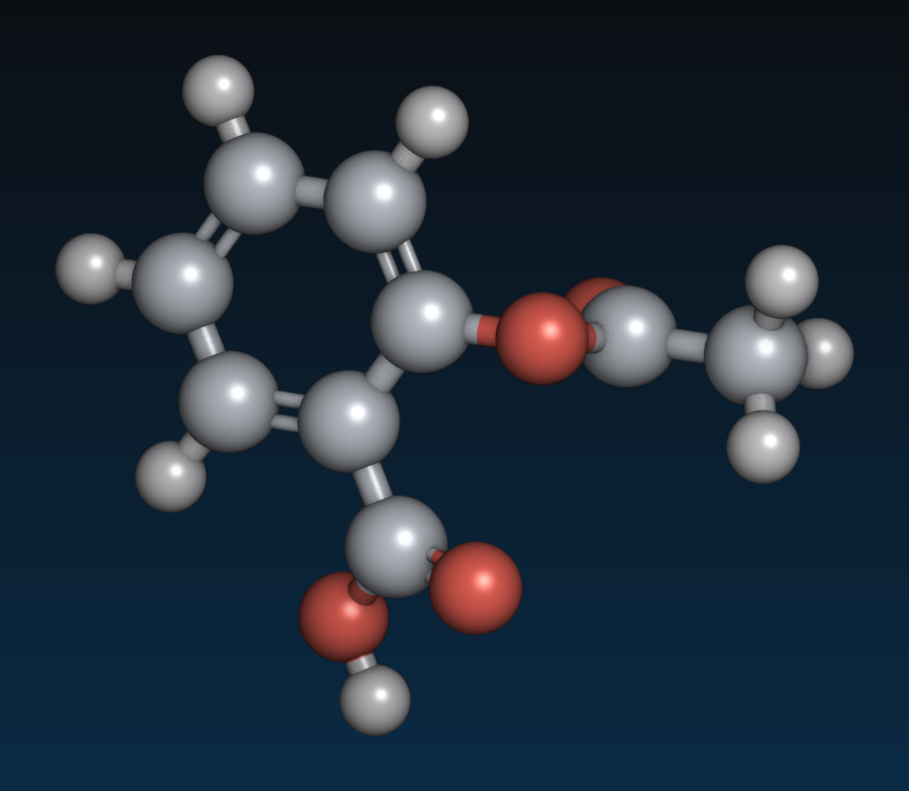

Exports are transparent by default. The 1600 px default is 1600x1394 and 640580 bytes.
All four corners have alpha 0. The image has 411581 pixels at alpha 255 and 22185 partial
pixels. The background and gradient controls apply when Transparent is off.

The width field takes any value from 400 to 4096 px. The supersample select offers 2x, 3x
and 4x. A large width lowers the factor. The render edge stays at or below 8192 px. The
2000 px 4x export would be 8000x10884, and it did not complete here. The 3x export did. At
2000 px the factor is 3x, a 6000x8163 render. The export is 2000x1741 and 936228 bytes. It
took 10.7 s end to end. At 1200 px the factor is 4x, a 4800x6532 render. The margin range
is 4 to 9 percent.

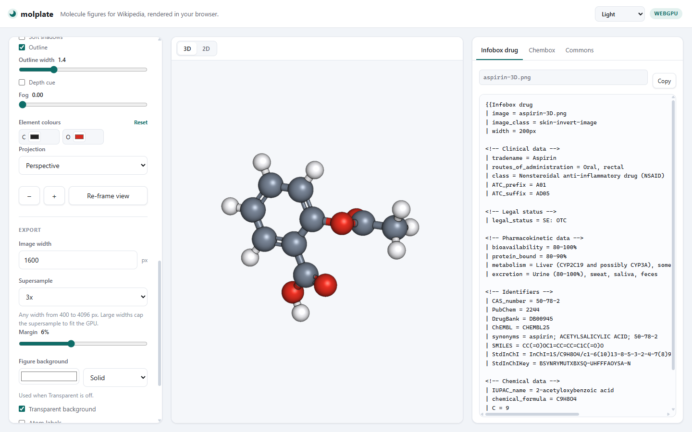

## E. Sources and metadata

The page reads three sources beside PubChem.

| Source | Data | Status |
| --- | --- | --- |
| Wikidata | QID, CAS, DrugBank, ChEMBL, ATC codes | Reachable with CORS |
| Wikipedia infobox | routes, legal status, ATC, pharmacokinetics, class | Reachable with CORS |
| DailyMed | SPL set ID and labeler | No CORS header; openFDA serves the same SPL labels |

The metadata arrives after the figure. The image is drawn from PubChem alone, so it does
not wait on three other services. The summary and the markup update when the sources
answer. PubChem wins where both know a field.

The acceptance asked for the same render by name, CID and SMILES:

| Input | Output | SHA-256 |
| --- | --- | --- |
| `aspirin` | 1200x1045, 395452 bytes | `0E9EBDFA379158DB4A900041D81F9C54678D346F90A756F08E01C25029B7B6FD` |
| `2244` | 1200x1045, 395452 bytes | the same hash |
| `CC(=O)OC1=CC=CC=C1C(=O)O` | 1200x1045, 395452 bytes | the same hash |

The added fields in the summary: ATC `A01AD05`, routes `Oral, rectal`, legal status
`SE: OTC`, Wikidata `Q18216`, DrugBank `DB00945`, ChEMBL `CHEMBL25`, and a label from
openFDA. The drugbox now emits:

```
| routes_of_administration = Oral, rectal
| ATC_prefix = A01
| ATC_suffix = AD05
| legal_status = SE: OTC
```

## F. Interface

The top bar has a theme picker with Light, Paper, Dark and System. An inline script applies
the stored choice before the first paint. Light uses cool neutrals, Paper uses warm cream,
Dark uses a deep slate. The accent is teal in Light and Dark, and copper in Paper. The stage
background follows the theme. The exported figure keeps its own background, so a white
Wikipedia figure stays white.

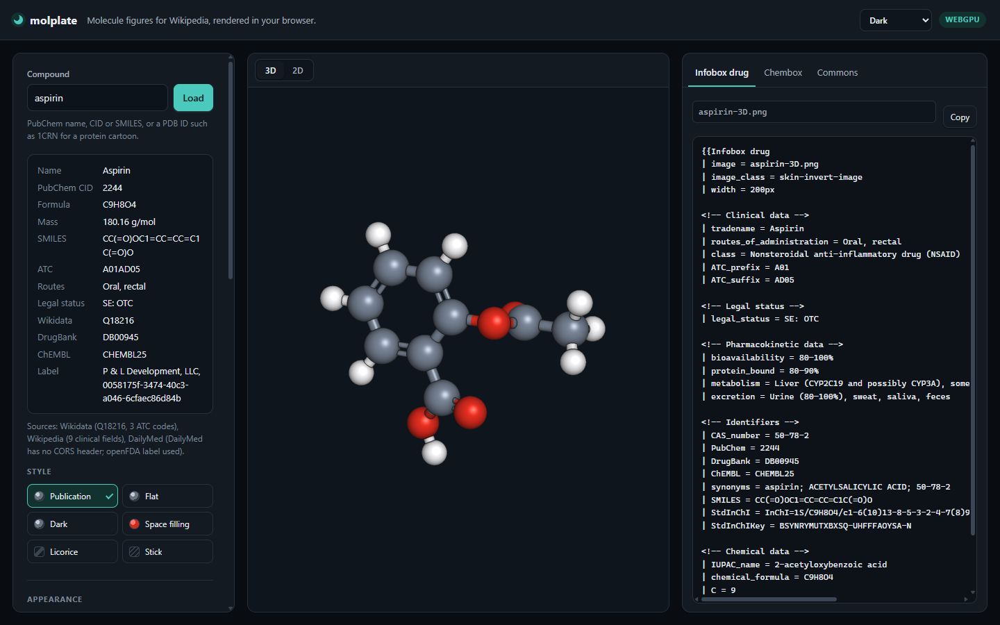

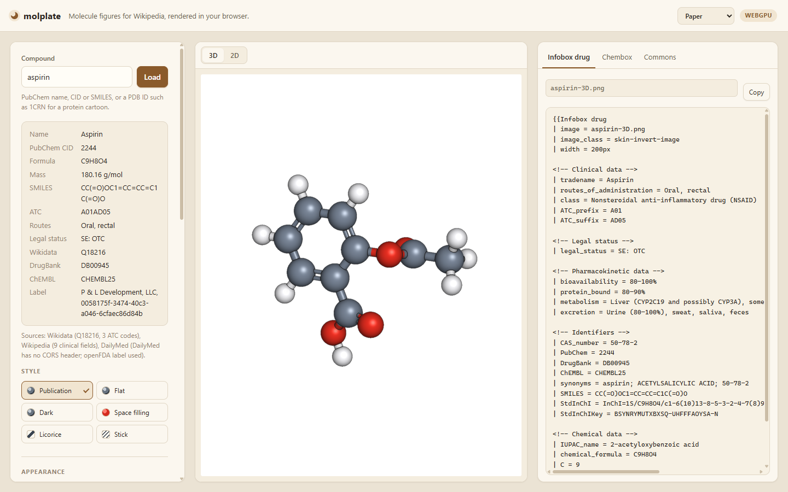

The patinae surface is opaque, so the stage paints the `--stage-tint` colour instead of
alpha. The 2D SVG is truly transparent.

The stage has a 3D and 2D switch, and the stage note says which view is live. The style
picker is a two-column list with a CSS swatch per representation. The appearance panel
exposes every look field. A spinner and an indeterminate bar show slow steps, with the
step name.

Shortcuts: `/` focuses the compound field. `Ctrl+Enter` loads. `2` and `3` switch view.
`E` exports. `F` re-frames. `+` and `-` zoom. `?` shows the list.

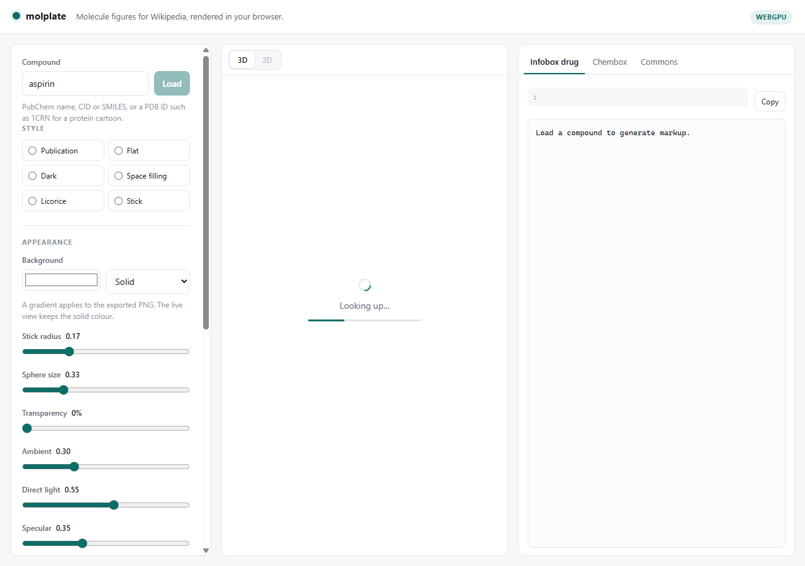

The keyboard path needs no mouse. Type `aspirin`, press `Ctrl+Enter`, wait for the figure,
then press `E`. The browser completed the download.

Layout at 1280 px. The page scroll width equals the viewport, 1280 px. The code panel
scrolls inside itself, as a code block should.

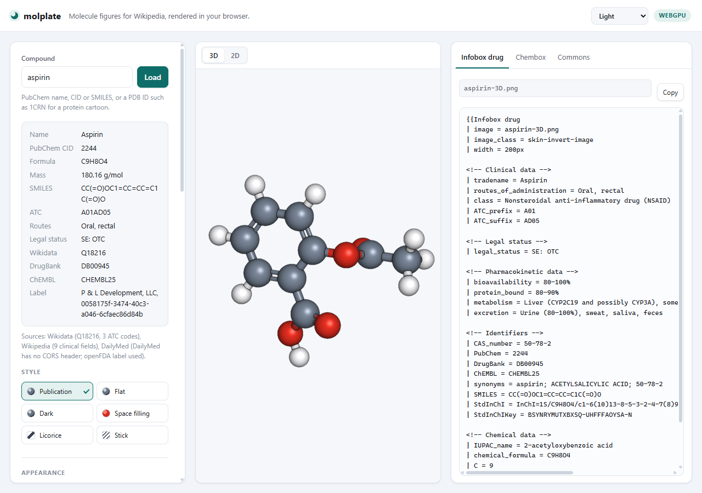

Layout at 800 px. The page scroll width equals the viewport, 800 px. The stage comes first,
so the molecule stays visible above the long control panel.

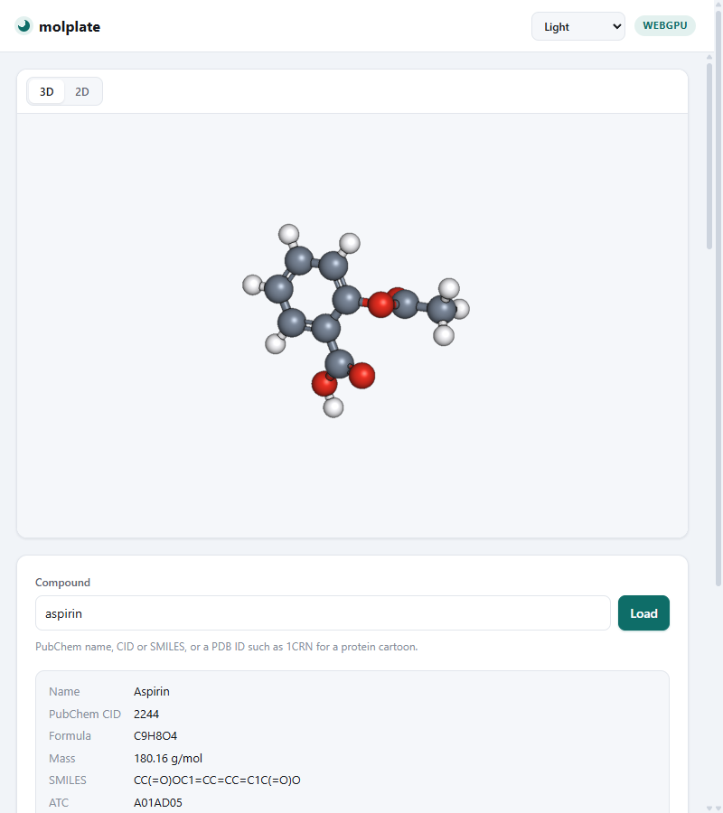

Without a WebGPU adapter, the stage reports the renderer error. The lookup, the summary,
the 2D SVG and the markup still work, and the SVG export button stays live. That run used
SwiftShader, which removes the hardware adapter this renderer needs.

## Verification

| Check | Result |
| --- | --- |
| `cargo test -p molplate_core` | 37 unit tests pass |
| Depiction integration tests | 6 tests pass |
| `cd web; npm run build` | TypeScript clean, Vite build OK |
| `node scripts/verify.mjs --url http://localhost:5173/ --headed true --gpu hardware` | OK, 2D SVG 8716 chars, export 1200x1045 at 6 percent |
| `pwsh -File scripts/build-dual.ps1 -NoServe` | classic and current builds OK |
| Keyboard export | completed |
| Themes | Light, Paper and Dark apply; a stored choice survives a reload |
| Stage tint | canvas pixel matches the theme: light (245,247,250), dark (15,21,28) |
| Export quality | 2000 px at 3x is a 6000x8163 render; 1200 px at 4x is 4800x6532 |
| Layout overflow | page scroll width equals the viewport at 1280 and 800 |

Bundle: the page is 46.00 KB of JavaScript and 13.75 KB of CSS. The app's wasm grows from
531.77 KB to 623.61 KB, and it gzips to 222.40 KB. The 2D engine is a separate 7.39 MB
wasm, loaded only when 2D opens. The fallback depiction, the composer and the scale bar
font live in the app wasm. The classic renderer's wasm is 17.6 MB for comparison.

## Gaps that remain

* MSAA in the live view. patinae has no MSAA. The 2x canvas and FXAA remain the substitute.
  The measured live edge ramp is 0.62 px from commit `6c56ec2`.
* V3000 mol blocks in the Rust fallback. RDKit handles V3000; the fallback parser does not.
* The first 2D open downloads 7.39 MB. The browser caches it, and the page states the cost.
* Conformer generation for a SMILES that PubChem does not know. PubChem resolves the
  structures today, so the gap is invisible until a lookup misses.
* Ray tracing. The ray tracer is a native plugin and is absent from the wasm build.
* A live background gradient. The canvas is opaque. The gradient is export-only.
* True alpha in the live 3D view. The patinae surface is opaque, so the stage paints the
  theme tint. The 2D SVG and the offscreen PNG export can be transparent.
* A direct DailyMed read. The service sends no CORS header. openFDA supplies the label.
* 3D atom labels show atom names. The label expression has no element field. For an SDF
  the atom name is the element symbol, so the figure reads `O` and `H`. For a PDB it reads
  `N`, `CA`, and so on.
* A protein has no 2D view. The cartoon is the useful figure, and the 2D tab is disabled.

## Next step

Make the 3D label text exact for every input. The clean fix is a renderer label expression
for the element symbol. A browser-side projection of atom centres with a depth test is the
fallback. The first option is a small upstream change, and it removes the last visible
difference between the two label paths.

After that, add a one-click figure preset (look, width and margin in one control). The
current controls work, but a Wikipedia editor will use the same three settings every time.
